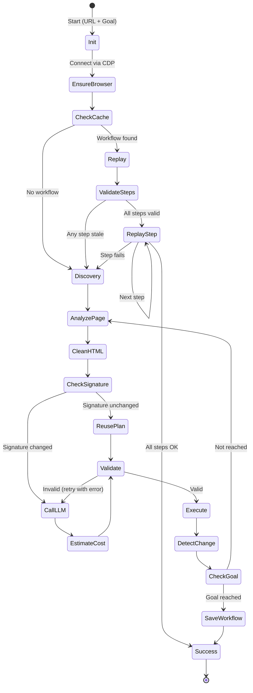

# Architecture

This document explains the design decisions behind `llm-web-agent`.
It is written for engineers who want to understand **why** the code looks
the way it does, not just what it does.

---

## The Four Pillars

### 1. Context Intelligence — HTML Reduction

**Problem**: raw HTML from a modern site is 200 KB to 2 MB. Sending it
to an LLM costs $0.05 to $0.50 per step, and most of the content is
irrelevant (scripts, styles, decorative divs).

**Solution**: `html_processor.py` extracts only interactive elements
(buttons, inputs, links, forms, headings) and compacts their attributes.
A typical reduction: **42 KB → 1.5 KB (96%)**.

**Trade-off**: the LLM loses the visual context (layout, spacing, hierarchy).
In practice, this does not matter — the agent only needs to know what is
clickable or fillable.

**Secondary effect (hypothesis)**: the reduced HTML should be *easier* for
the LLM to reason about. The target is a hallucination rate below 2%, down
from an estimated ~40% on raw HTML. This will be confirmed by the benchmark
planned in the roadmap.

### 2. Memory Intelligence — Workflow Cache

**Problem**: running the same task twice should not cost twice. The LLM
already told us how to do it once.

**Solution**: after a successful run, the agent saves the workflow
(sequence of `{action, selector, value_template}` steps) to SQLite.
The next run replays it without any LLM call.

**Staleness handling**: each step tracks `last_success_at` and
`fail_count`. A step is considered stale if:

- It has not succeeded in the last 7 days, OR
- It has failed 3 or more consecutive times.

When a step is stale, the workflow is marked as unreliable and the agent
falls back to discovery mode.

**Graceful degradation**: if the LLM API is down, cached workflows still
run. This is a key feature — you can demo the project to a recruiter
even if you have no API credits left.

### 3. Decision Intelligence — State Machine

**Problem**: web automation is not linear. Pages redirect. Popups steal
focus. Forms have multiple steps.

**Solution**: the agent runs a state machine with two modes:

**Mode A — Discovery** (no cache):

```
analyze page → call LLM → validate → execute → detect change → repeat
```

The loop ends when either:
- the LLM sets `is_goal_reached: true`, or
- `max_steps` is reached, or
- an unrecoverable error occurs.

**Mode B — Replay** (cache hit):

```
for each cached step:
    if step is stale: fall back to discovery
    execute step
    verify effect
    if verification fails: fall back to discovery
mark workflow as used
```

The two modes share the same execution primitives (`tab_manager.py`,
`browser/browser_utils.py`). Only the decision layer differs.

**DOM signature caching**: inside discovery mode, the agent computes a
SHA256 signature of the interactive elements on each page. If the
signature is unchanged between two consecutive steps, the agent reuses
the previous LLM plan instead of calling again. This avoids redundant
API calls on static pages.

### 4. Reliability — Validation & Human-in-the-Loop

**Problem**: LLMs hallucinate. A selector may not exist, or match multiple
elements, or target the wrong element.

**Solution**: three-layer validation (see `validator.py`,
`validator_dynamic.py`, and the `_post_step_check` in `agent.py`).

**Human-in-the-loop**: before each LLM call, the agent displays an estimated
token cost and asks for confirmation (`y/n`). This is disabled with `--yes`
for automation.

---

## State Diagram



---

## Architecture Decision Records

### ADR-001: SQLite vs Postgres for workflow storage

**Context**: need to persist workflows, steps, and run history per domain.

**Options**:

| Option | Pros | Cons |
|---|---|---|
| SQLite | Zero setup, single file, fast reads | Single-writer, no network |
| Postgres | Multi-user, network, rich queries | Server required, migrations, overhead |
| JSON files | Simple | No queries, no transactions, race conditions |

**Decision**: SQLite by default. Postgres support in v1.1 behind the same
interface.

**Rationale**:

- The agent runs on a single machine for a single user. No concurrency.
- < 1000 workflows expected. No need for query optimization.
- `workflow_manager.py` is the only file that touches the database.
  Swapping to Postgres is a 50-line change.
- Backup is `cp workflows.db backup.db`. This is a feature, not a bug.

**Reversal cost**: ~2 hours (add `psycopg2` backend, migration script).

---

### ADR-002: FastAPI vs Flask for the API

**Context**: v1.1 adds a REST API and a dashboard.

**Options**:

| Option | Pros | Cons |
|---|---|---|
| Flask | Mature, simple | Sync by default, no built-in validation |
| FastAPI | Native async, Pydantic, free OpenAPI docs | Newer, slight learning curve |

**Decision**: FastAPI.

**Rationale**:

- Playwright's async API needs a non-blocking event loop. FastAPI provides
  it natively. With Flask, every browser call would need
  `run_in_executor` wrapping.
- Pydantic models validate request bodies automatically. Fewer lines of
  manual validation.
- Free OpenAPI docs at `/docs`. Useful for demos and for future integrations.

**Reversal cost**: ~4 hours (rewrite routes, drop Pydantic).

---

### ADR-003: Playwright sync vs async

**Context**: Playwright offers both `sync_api` and `async_api`.

**Decision**: sync API.

**Rationale**:

- The agent processes one task at a time. There is no concurrency to
  exploit.
- Sync code is easier to read and debug for a solo developer.
- Async Playwright would add `async`/`await` everywhere with no benefit
  for the current use case.
- If parallelism is needed in the future, the sync API can run in
  separate processes (`multiprocessing`). This is a cleaner upgrade path
  than rewriting to async.

**Reversal cost**: ~6 hours (mechanical rewrite, but error-prone).

---

### ADR-004: Static + dynamic validation

**Context**: selector validation can be done statically (BeautifulSoup)
or dynamically (Playwright locator).

**Decision**: both, in sequence.

**Rationale**:

- Static validation is fast (~10 ms) and catches most hallucinations.
- Dynamic validation catches Playwright-only selectors (`:has-text()`)
  and cases where BeautifulSoup's CSS engine disagrees with Chromium.
- Running static first avoids launching the browser for obvious failures.
- Running dynamic second ensures we validate against the **real** engine.

**Reversal cost**: low — either validator can be disabled with a flag.

---

### ADR-005: HTMX vs React for the dashboard

**Context**: v1.1 adds a web dashboard to view workflows and runs.

**Options**:

| Option | Pros | Cons |
|---|---|---|
| React + Vite | Modern, rich ecosystem | 500 MB node_modules, build step, complex |
| HTMX + Jinja2 | 30 KB JS, no build, Python-only | Less "shiny" visually |
| Streamlit | Ultra-fast to build | Not for CRUD apps, poor UI control |

**Decision**: HTMX + Jinja2.

**Rationale**:

- The dashboard is a CRUD interface (list workflows, view details, delete).
  React is overkill.
- HTMX handles all interactions with HTML attributes. No JavaScript to write.
- Jinja2 templates are fast to iterate on and easy to style with plain CSS.
- No build step means no `npm install`, no `node_modules`, no
  `package.json`. A single `pip install` is enough.
- On a 2018 i5 with 20 GB of RAM, a fast dashboard matters more than a
  fancy one.

**Reversal cost**: ~6 hours (rewrite templates in React, add build config).

---

## File Organization

```
llm-web-agent/
│
├── agent.py                The orchestrator. Runs discovery and replay modes.
├── run.py                  CLI entry point. Parses arguments, loads tasks.
├── api.py                  FastAPI app (v1.1). Serves API + dashboard.
│
├── llm/                    LLM providers (multi-provider, common interface).
│   ├── base.py             Abstract BaseLLMClient + LLMError + LLMResponse.
│   ├── deepseek.py         DeepSeek client (default).
│   ├── openai.py           OpenAI client (GPT-4o, GPT-4o-mini).
│   ├── anthropic.py        Anthropic client (Claude Sonnet, Haiku).
│   ├── grok.py             Grok client (OpenAI-compatible API).
│   ├── ollama.py           Local LLM client (v1.2).
│   └── factory.py          create_client(config) → BaseLLMClient.
│
├── validator.py            Static validation (BeautifulSoup).
├── validator_dynamic.py    Dynamic validation (Playwright).
├── html_processor.py       HTML reduction + iframe extraction + DOM signature.
├── tab_manager.py          Click with popup handling.
│
├── browser/                Browser connection and isolation.
│   ├── browser_utils.py    connect_local_chrome() / connect_container_chrome().
│   ├── container_manager.py Docker lifecycle (build, start, stop, health).
│   ├── Dockerfile.browser  Minimal Chrome image.
│   └── start-chrome.sh     Xvfb + Chrome with CDP.
│
├── workflow_manager.py     SQLite (and Postgres in v1.1) persistence.
│
├── tasks/                  Predefined demo scenarios.
│   ├── saucedemo_checkout.py
│   ├── booking_search.py
│   └── wikipedia_extract.py
│
├── dashboard/              Web UI (v1.1).
│   ├── routes.py           FastAPI routes.
│   ├── templates/          Jinja2 templates (HTMX-powered).
│   └── static/             htmx.min.js, alpine.min.js, style.css.
│
├── migrations/             Database schema.
│   └── schema.sql
│
├── tests/                  Unit tests.
│   ├── test_validator.py
│   ├── test_html_processor.py
│   ├── test_workflow_manager.py
│   └── test_tasks.py
│
└── docs/                   This documentation.
```

**Rule**: no module imports from `agent.py` except `run.py` and `api.py`.
This keeps the dependency graph acyclic and the modules independently
testable.
